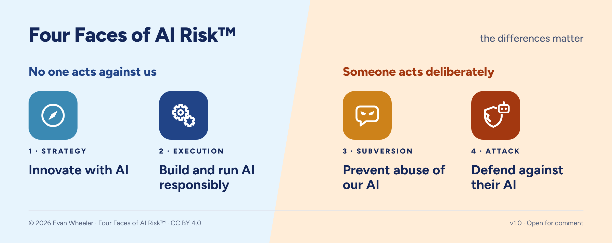
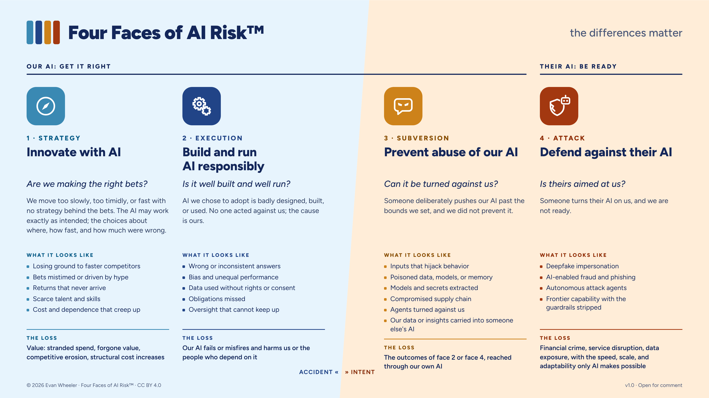

# Four Faces of AI Risk™

<picture>
  <source media="(prefers-color-scheme: dark)" srcset="graphics/dark/F1D-Quick-glance-headline-dark.png">
  
</picture>

**“AI risk” is not one risk. It is four, with different causes, owners, controls, data, and forms of loss, and nothing useful happens in an assessment until you say which one you mean.**

Four Faces of AI Risk sorts any AI risk by its cause before you try to measure it. Each face has its own cause, owner, controls, and data, so each becomes its own risk scenario instead of one blended worry.

*v1.0 · Open for comment.* Questions and pushback are welcome; see [Proposing changes](#proposing-changes). The full page is at [riskframework.org](https://www.riskframework.org/four-faces/), and how-to articles on applying it are in [Thinking](https://www.riskframework.org/thinking/).

---

## What's in this repository

| File | What it is | Use it when |
|---|---|---|
| `Four-Faces-of-AI-Risk.pdf` | The overview: what Four Faces is, how it works, and the thinking behind its design, in ten pages. | You are new to it, or want something to pass around. **Start here.** |
| `Four-Faces-of-AI-Risk.md` | The usage guide: the four faces, how to place a risk, edge rules, worked examples, the finance view, vocabulary, and instructions for an AI assistant. | You want the full rules, or want to load the framework into your own AI assistant. |
| `Four-Faces-of-AI-Risk-Deck.pptx` | The presentation deck, editable, with speaker notes. `-dark.pptx` is the same deck on a dark background. | You are presenting to executives or a risk committee. |
| `graphics/` | The model (`M1`), the four faces over the AI Risk Map (`M2`), and four quick-glance strips (`F1`–`F4`). `graphics/dark/` has the same set for dark backgrounds. | Slides, posts, intranet pages. |
| `four-faces.json` | The faces, questions, rules, and vocabulary as structured data. | You are building a tool or workflow on top of the framework. |
| `LICENSE` | CC BY 4.0 legal text. | |

## The four faces

| Face | The question | In short |
|---|---|---|
| **1 · Strategy** Innovate with AI | *Are we making the right bets?* | We bet wrong. |
| **2 · Execution** Build and run AI responsibly | *Is it well built and well run?* | We botched it. |
| **3 · Subversion** Prevent abuse of our AI | *Can it be turned against us?* | They hijacked ours. |
| **4 · Attack** Defend against their AI | *Is theirs aimed at us?* | They attacked with theirs. |

The first three are about our AI: **get it right**. The fourth is about theirs: **be ready**.

## Placing a risk

Ask three questions, in order:

1. **Whose AI?**
   - Theirs, aimed at us → face 4.
2. **Ours (our AI, or the data, models, and outputs it is built from or produces). Did someone deliberately push it past the bounds we set?**
   - Yes → face 3.
3. **No. Where did it go wrong?**
   - In how AI we chose was built or run, causing an operational failure → face 2.
   - Where we chose to invest, how fast, and how much, causing a strategic shortfall → face 1.

This is not a 2×2. Faces 1 and 2 share a cell and are split by a third question: was it the choice of bets, or how a chosen AI was built and run?

The guide's edge rules settle the harder cases, and its worked example splits one register line into six scenarios across all four faces.

## How to use it

| Setting | What to do |
|---|---|
| **In a workshop** | Sort the fears in the room into faces before anyone starts naming risks. |
| **Scoping a scenario** | Ask the three questions first. The face sets the cause, and the cause drives frequency. |
| **With executives** | Lead with the finance view and the shorthand. Use the deck. |

**With your AI assistant.** Load `Four-Faces-of-AI-Risk.md` into your tool of choice. Its section *Using this file with an AI assistant* gives the assistant the rules for placing a risk, so you can ask it to sort a risk register and to say when a risk needs more than one scenario.

## Using it with the AI Risk Map™

Four Faces works on its own. A risk-factor library widens each face's scope. The AI Risk Map is a companion library built to be used with it. It lists AI-specific causes, safeguard gaps, amplifiers, and outcomes, organized by who owns them. Where the AI Risk Map is available, name the face first, then use its factors to find what else could cause or worsen that scenario. Where it isn't, the rules here stand alone.

The AI Risk Map covers faces 1–3. Face 4 is outside its subject boundary by design and belongs on the threat register. The AI Risk Map is a separate work by the same author, licensed CC BY-SA 4.0: [https://github.com/wheels344i-gte/ai-risk-map](https://github.com/wheels344i-gte/ai-risk-map).

## What it is not

- **Not a catalog or a governance framework.** It names four kinds of risk. It does not list risk factors or controls, and it does not tell you how to govern AI.
- **Not a measurement method.** It helps you define scenarios well enough to measure. How you estimate frequency and loss is the job of your measurement method.
- **Not a prioritization.** Faces are sorted into, not ranked. Four Faces alone does not tell you which risks to address first.
- **Not an org chart.** Owners vary by organization. Assigning them is the next conversation.

**Limitations**

- Intent is not always known when you scope. When it isn't, scope more than one face.
- Face 1 is measured differently: as variance against a plan, at the pace of decision cycles.

## Frequently asked

**Why four?**
We didn't pick four. The causes did. Did somebody do this to us? If no: was it the bet or the build? If yes: did they use our AI or theirs?

**Does the face tell me how big a risk is?**
No. The faces sort risk; they don't measure it. Placing a scenario in a face tells you who has to act and what drives its frequency, not how often it will happen or what it will cost. That is the next step in the analysis.

**How do I cite it?**
> Wheeler, E. (2026). *Four Faces of AI Risk* v1.0. Licensed CC BY 4.0. https://github.com/wheels344i-gte/ai-four-faces/releases/tag/v1.0

**How do I link to it?**
File names carry no version number, so links don't break when a new version ships. The current version is stated inside every file and in the [release list](https://github.com/wheels344i-gte/ai-four-faces/releases).

| You want | Link pattern |
|---|---|
| Always the current version (websites, slides, bookmarks) | `https://github.com/wheels344i-gte/ai-four-faces/blob/main/Four-Faces-of-AI-Risk.md` |
| One specific version, unchanging (citations, audits) | `https://github.com/wheels344i-gte/ai-four-faces/blob/v1.0/Four-Faces-of-AI-Risk.md` |
| The file itself, for tools, scripts, AI assistants, or embedding an image | Replace `blob` with `raw` in either link above |

Replace `Four-Faces-of-AI-Risk.md` with any file in the table above.

## Proposing changes

Proposals are welcome, **as Issues, not pull requests.** The files in this repository are generated from a single source that is not published here, so a pull request cannot be merged; it would be overwritten by the next build. Open an Issue instead. Every proposal is reviewed by the author, and accepted changes appear in the next release.

The most useful proposal is a real risk you could not place in exactly one face, or that the three questions placed somewhere that felt wrong. Describe the risk, say where the questions put it, and say where you think it belongs.

## Trademark

Four Faces of AI Risk™ is a trademark of Evan Wheeler. The name identifies Evan Wheeler's framework.

The license below covers the content. It does not grant permission to use the name in a way that suggests sponsorship, endorsement, or affiliation, or that a modified version is the official release. You may use the name accurately to identify or cite this work. If you adapt the framework, identify your version as modified and do not present it as the official Four Faces of AI Risk. Using the name to brand a separate product or commercial service, or in any way that may cause confusion, requires separate permission.

## License

© 2026 Evan Wheeler. Licensed under [Creative Commons Attribution 4.0 International](https://creativecommons.org/licenses/by/4.0/). You may share and adapt this work for any purpose, including commercially, provided you give attribution. Full text in `LICENSE`.
